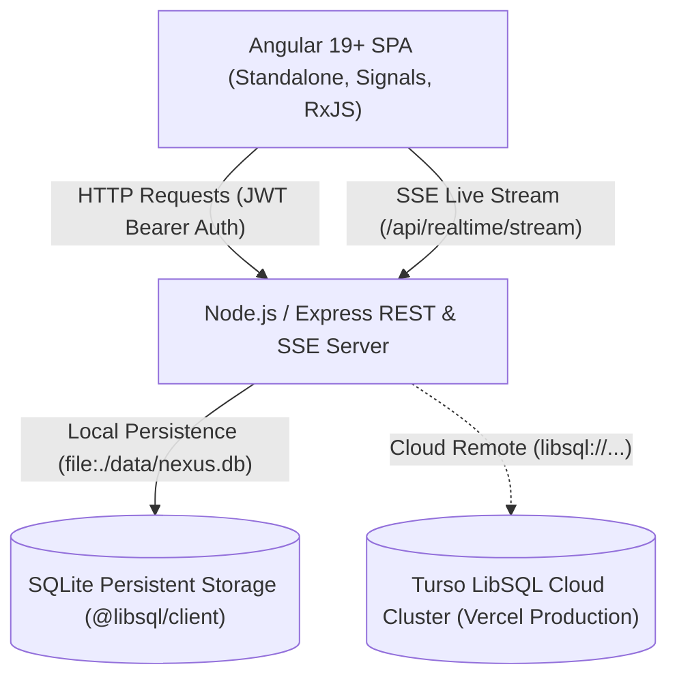

# Nexus PMS ? Full-Stack System Architecture

This document describes the high-level architecture, subsystem boundaries, data flow pipelines, and technical design decisions powering the Nexus Enterprise Project Management System.

---

## 1. High-Level System Architecture



---

## 2. Frontend Subsystem Architecture (`/frontend`)

The frontend adheres to an enterprise-grade modular structure divided into three distinct layers:

```
frontend/src/app/
??? core/         # Singleton services, state stores, guards, HTTP interceptors, models
??? features/     # Feature-oriented lazy-loaded standalone components
??? shared/       # Reusable presentational components, directives, and pure pipes
```

### Layer Responsibilities

1. **`core/` (Application Backbone)**:
   - **`auth/`**:
     - `auth.guard.ts`: Functional route guard inspecting authentication signals.
     - `role.guard.ts`: Functional guard enforcing RBAC constraints defined on route metadata.
     - `auth.interceptor.ts`: Attaches `Authorization: Bearer <token>` to outbound requests.
     - `error.interceptor.ts`: Intercepts 401 Unauthorized responses to trigger automatic logout and navigation.
   - **`models/`**: Strongly-typed interfaces for `User`, `Organization`, `Project`, `Task`, `Comment`, `Activity`, and `Analytics`.
   - **`services/`**: Domain services (`AuthService`, `ProjectService`, `TaskService`, `NotificationService`, `RealtimeService`, `ThemeService`, `ToastService`).

2. **`features/` (Domain Workflows)**:
   - **`auth/`**: Login, registration, and quick-switch demo accounts.
   - **`dashboard/`**: Executive telemetry, KPI metric cards, project velocity meters, and live activity streams.
   - **`projects/`**: Portfolio listing, debounced search filtering, project charter detail views, and creation modals.
   - **`tasks/`**: Interactive 4-column Kanban board with HTML5 drag-and-drop status transitions, task modals, and threaded comments.
   - **`organizations/`**: Multi-tenant workspace controls, member management tables, and role administration.
   - **`analytics/`**: Engineering workload distribution matrix and SVG priority breakdown charts.
   - **`settings/`**: User profile configuration, password changes, and dark/light theme switching.

3. **`shared/` (Reusable Elements)**:
   - **Components**: `NavbarComponent`, `SidebarComponent`, `ModalComponent`, `StatCardComponent`, `ToastContainerComponent`.
   - **Directives**: `HasRoleDirective` (`*appHasRole`), `TooltipDirective` (`[appTooltip]`), `PriorityHighlightDirective` (`[appPriorityHighlight]`).
   - **Pipes**: `TimeAgoPipe`, `PriorityBadgePipe`, `StatusBadgePipe`, `InitialsPipe`, `SearchFilterPipe`.

---

## 3. Backend Subsystem Architecture (`/backend`)

The backend is built with Node.js and TypeScript, designed for fast development iteration and seamless deployment to serverless environments (such as Vercel Functions):

```
backend/src/
??? config/       # Environment variables, ports, secrets, DB connection URLs
??? db/           # SQLite connection client, migration engine, comprehensive seed data
??? middleware/   # Authentication, role-based authorization, centralized error handling
??? realtime/     # EventBroadcaster hub managing SSE client streams
??? routes/       # Domain routers (auth, org, project, task, comment, activity, analytics, realtime)
??? index.ts      # Server bootstrap and Express application configuration
```

### Real-Time Event Hub (`src/realtime/events.ts`)
- Implements a pub/sub event broadcaster leveraging Server-Sent Events (SSE).
- Enables instant multi-client synchronization: when an engineer drags a task from *In Progress* to *Review*, the event is broadcasted across all active client streams in under 50ms without polling.

---

## 4. Architectural Decision Records (ADRs)

### ADR-01: Angular Signals as Primary State Store over NgRx
- **Context**: State management in Angular has historically relied on NgRx or RxJS BehaviorSubjects.
- **Decision**: Adopt Angular 19 native Signals (`signal`, `computed`, `effect`) backed by lightweight domain services.
- **Rationale**: Signals provide fine-grained reactivity with zero boilerplate. Unlike RxJS Observables, reading a Signal in a template does not require the `async` pipe or manual unsubscribe tracking. Signals offer superior change detection performance with `OnPush`.

### ADR-02: SQLite with LibSQL (`@libsql/client`) for Database Persistence
- **Context**: The application required SQLite persistence compatible with both local development and Vercel serverless deployments.
- **Decision**: Use `@libsql/client`.
- **Rationale**: Standard `better-sqlite3` uses native C++ compilation which frequently fails in serverless environments, and raw local file SQLite is ephemeral on Vercel. `@libsql/client` seamlessly operates over a local file (`file:./data/nexus.db`) in development, and transparently routes to a persistent cloud Turso LibSQL database in production without altering a single query.

### ADR-03: Server-Sent Events (SSE) for Real-Time Telemetry
- **Context**: The maritime and logistics domain requires live tracking updates and collaborative status moves.
- **Decision**: Implement SSE over HTTP (`/api/realtime/stream`) with automatic reconnection and fallback.
- **Rationale**: SSE operates cleanly through standard HTTP/2 proxies, firewalls, and serverless hosting with less overhead than bidirectional WebSockets, perfectly suiting notification feeds and Kanban movements.
