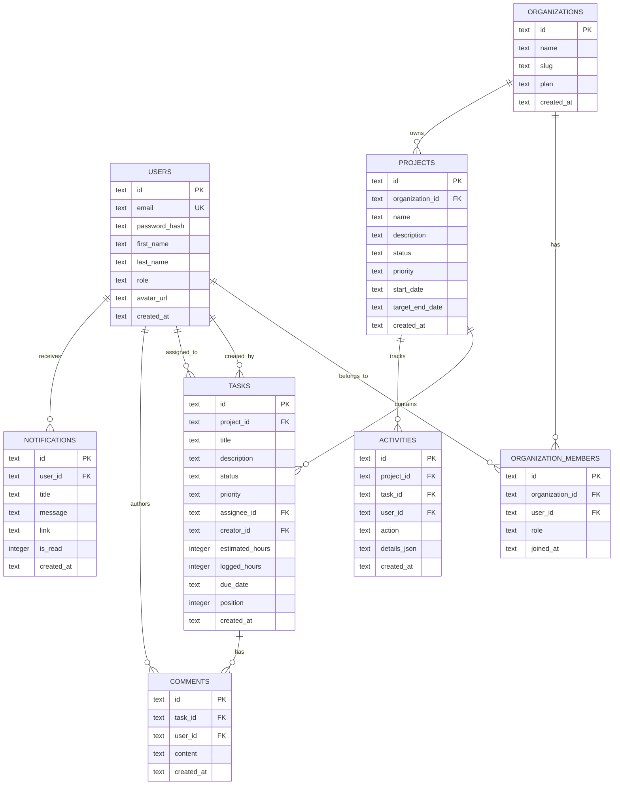

# Database Architecture & Persistence in Nexus PMS

This document details the database schema, entity relationships, query patterns, indexing strategy, and hybrid persistence architecture designed for **Nexus PMS**.

---

## 1. Persistence Architecture: Local SQLite & Vercel Cloud Compatibility

### The Serverless SQLite Challenge
Traditional Node.js SQLite drivers (`sqlite3`, `better-sqlite3`) compile native C++ binaries (gyp bindings) and rely on a persistent local filesystem. When deployed to serverless environments such as **Vercel Functions** or **AWS Lambda**:
1. Filesystem writes are ephemeral; changes made inside a serverless invocation vanish upon container teardown.
2. Read-only limitations in serverless environments can block database creation.
3. Concurrent serverless instances cannot coordinate writes to an uncoordinated flat file without file locking corruption.

### The Solution: Hybrid Driver with `@libsql/client`
Nexus PMS uses `@libsql/client` (an open-source fork of SQLite maintained by the creators of Turso). This provides a **unified API** that works in two modes without changing a single line of backend application code:

```
??????????????????????????????????????????????????????????
?             Nexus PMS Backend Database Layer           ?
?                 (backend/src/db/client.ts)             ?
??????????????????????????????????????????????????????????
                            ?
              ?????????????????????????????
              ?                           ?
   Development / Local CLI      Production / Vercel Serverless
   ???????????????????????      ??????????????????????????????
   Driver: `@libsql/client`     Driver: `@libsql/client`
   URL: `file:./data/nexus.db`  URL: `libsql://your-db.turso.io`
   Target: Embedded SQLite file Target: Distributed Cloud LibSQL
   Zero-network offline dev     Global persistence & replication
```

### Environment Configuration
```bash
# Development (.env)
DATABASE_URL="file:./data/nexus.db"

# Production (Vercel Environment Variables)
DATABASE_URL="libsql://nexus-pms-prod.turso.io"
DATABASE_AUTH_TOKEN="eyJh...your-turso-jwt-token"
```

---

## 2. Entity-Relationship Model (ERD)



---

## 3. Database Schema Definitions

All tables use parameterized SQL migration scripts in `backend/src/db/schema.ts`.

### 1. `users`
Stores user identities, credentials, and global system roles.
```sql
CREATE TABLE IF NOT EXISTS users (
  id TEXT PRIMARY KEY,
  email TEXT UNIQUE NOT NULL,
  password_hash TEXT NOT NULL,
  first_name TEXT NOT NULL,
  last_name TEXT NOT NULL,
  role TEXT NOT NULL DEFAULT 'DEVELOPER', -- 'ADMIN' | 'PROJECT_MANAGER' | 'DEVELOPER' | 'VIEWER'
  avatar_url TEXT,
  created_at TEXT NOT NULL DEFAULT (datetime('now')),
  updated_at TEXT NOT NULL DEFAULT (datetime('now'))
);
```

### 2. `organizations` & `organization_members`
Enables multi-tenancy and team rosters.
```sql
CREATE TABLE IF NOT EXISTS organizations (
  id TEXT PRIMARY KEY,
  name TEXT NOT NULL,
  slug TEXT UNIQUE NOT NULL,
  plan TEXT NOT NULL DEFAULT 'ENTERPRISE',
  created_at TEXT NOT NULL DEFAULT (datetime('now'))
);

CREATE TABLE IF NOT EXISTS organization_members (
  id TEXT PRIMARY KEY,
  organization_id TEXT NOT NULL REFERENCES organizations(id) ON DELETE CASCADE,
  user_id TEXT NOT NULL REFERENCES users(id) ON DELETE CASCADE,
  role TEXT NOT NULL DEFAULT 'MEMBER', -- 'OWNER' | 'ADMIN' | 'MEMBER' | 'GUEST'
  joined_at TEXT NOT NULL DEFAULT (datetime('now')),
  UNIQUE(organization_id, user_id)
);
```

### 3. `projects`
Workspaces containing issues, sprints, and milestones.
```sql
CREATE TABLE IF NOT EXISTS projects (
  id TEXT PRIMARY KEY,
  organization_id TEXT NOT NULL REFERENCES organizations(id) ON DELETE CASCADE,
  name TEXT NOT NULL,
  description TEXT,
  status TEXT NOT NULL DEFAULT 'ACTIVE', -- 'PLANNING' | 'ACTIVE' | 'ON_HOLD' | 'COMPLETED' | 'ARCHIVED'
  priority TEXT NOT NULL DEFAULT 'MEDIUM', -- 'LOW' | 'MEDIUM' | 'HIGH' | 'CRITICAL'
  start_date TEXT,
  target_end_date TEXT,
  created_at TEXT NOT NULL DEFAULT (datetime('now')),
  updated_at TEXT NOT NULL DEFAULT (datetime('now'))
);
```

### 4. `tasks`
The core work items rendered on the Kanban board.
```sql
CREATE TABLE IF NOT EXISTS tasks (
  id TEXT PRIMARY KEY,
  project_id TEXT NOT NULL REFERENCES projects(id) ON DELETE CASCADE,
  title TEXT NOT NULL,
  description TEXT,
  status TEXT NOT NULL DEFAULT 'TODO', -- 'TODO' | 'IN_PROGRESS' | 'IN_REVIEW' | 'DONE'
  priority TEXT NOT NULL DEFAULT 'MEDIUM', -- 'LOW' | 'MEDIUM' | 'HIGH' | 'CRITICAL'
  assignee_id TEXT REFERENCES users(id) ON DELETE SET NULL,
  creator_id TEXT NOT NULL REFERENCES users(id),
  estimated_hours INTEGER DEFAULT 0,
  logged_hours INTEGER DEFAULT 0,
  due_date TEXT,
  position INTEGER NOT NULL DEFAULT 0,
  created_at TEXT NOT NULL DEFAULT (datetime('now')),
  updated_at TEXT NOT NULL DEFAULT (datetime('now'))
);
```

### 5. `comments`, `activities`, and `notifications`
Supports threaded discussions, audit logs, and alert feeds.
```sql
CREATE TABLE IF NOT EXISTS comments (
  id TEXT PRIMARY KEY,
  task_id TEXT NOT NULL REFERENCES tasks(id) ON DELETE CASCADE,
  user_id TEXT NOT NULL REFERENCES users(id) ON DELETE CASCADE,
  content TEXT NOT NULL,
  created_at TEXT NOT NULL DEFAULT (datetime('now'))
);

CREATE TABLE IF NOT EXISTS activities (
  id TEXT PRIMARY KEY,
  project_id TEXT NOT NULL REFERENCES projects(id) ON DELETE CASCADE,
  task_id TEXT REFERENCES tasks(id) ON DELETE CASCADE,
  user_id TEXT NOT NULL REFERENCES users(id) ON DELETE CASCADE,
  action TEXT NOT NULL, -- 'TASK_CREATED' | 'STATUS_CHANGED' | 'ASSIGNED' | 'COMMENT_ADDED'
  details TEXT, -- JSON payload of before/after metadata
  created_at TEXT NOT NULL DEFAULT (datetime('now'))
);

CREATE TABLE IF NOT EXISTS notifications (
  id TEXT PRIMARY KEY,
  user_id TEXT NOT NULL REFERENCES users(id) ON DELETE CASCADE,
  title TEXT NOT NULL,
  message TEXT NOT NULL,
  link TEXT,
  is_read INTEGER NOT NULL DEFAULT 0,
  created_at TEXT NOT NULL DEFAULT (datetime('now'))
);
```

---

## 4. Performance Indexes

To support rapid filtering, sorting, and joins on multi-tenant datasets, the following B-Tree indexes are applied automatically during schema migration:

```sql
-- Fast lookup of user email during login
CREATE INDEX IF NOT EXISTS idx_users_email ON users(email);

-- Fast scoping of projects by tenant
CREATE INDEX IF NOT EXISTS idx_projects_org ON projects(organization_id);

-- Rapid Kanban board queries (filter by project and status column)
CREATE INDEX IF NOT EXISTS idx_tasks_project_status ON tasks(project_id, status);

-- Assignee workload queries for dashboards and velocity metrics
CREATE INDEX IF NOT EXISTS idx_tasks_assignee ON tasks(assignee_id);

-- Unread notification count badge in top navigation
CREATE INDEX IF NOT EXISTS idx_notifications_user_read ON notifications(user_id, is_read);

-- Activity timeline queries ordered chronologically
CREATE INDEX IF NOT EXISTS idx_activities_project_time ON activities(project_id, created_at DESC);
```

---

## 5. Migrations & Seeding Workflow

### Migration Engine
Schema tables and indexes are checked and created idempotently via `backend/src/db/schema.ts` through `initializeDatabase()`. This function executes automatically on server startup:
```typescript
await db.executeMultiple(`
  PRAGMA foreign_keys = ON;
  CREATE TABLE IF NOT EXISTS ...
  CREATE INDEX IF NOT EXISTS ...
`);
```

### Database Seeding (`backend/src/db/seed.ts`)
Run the seed script at any time:
```bash
npm run seed --prefix backend
```
This populates:
- **4 Pre-configured Demo Users**:
  - `admin@nexus.io` (ADMIN)
  - `pm@nexus.io` (PROJECT_MANAGER)
  - `dev@nexus.io` (DEVELOPER)
  - `viewer@nexus.io` (VIEWER)
  - *(All passwords hashed using bcrypt: `Password123!`)*
- **2 Organizations**: Kobkiat Global, Nexus Cloud Systems.
- **3 Production Projects**:
  1. *Kobkiat Cargo Vessel Tracking System* (HIGH)
  2. *Real-time Freight Telemetry Dashboard* (CRITICAL)
  3. *Client Portal & Document Vault* (MEDIUM)
- **11 Real-World Kanban Tasks** across all columns (`TODO`, `IN_PROGRESS`, `IN_REVIEW`, `DONE`).
- **Threaded Task Comments, Audit Activities, and In-App Notifications**.
