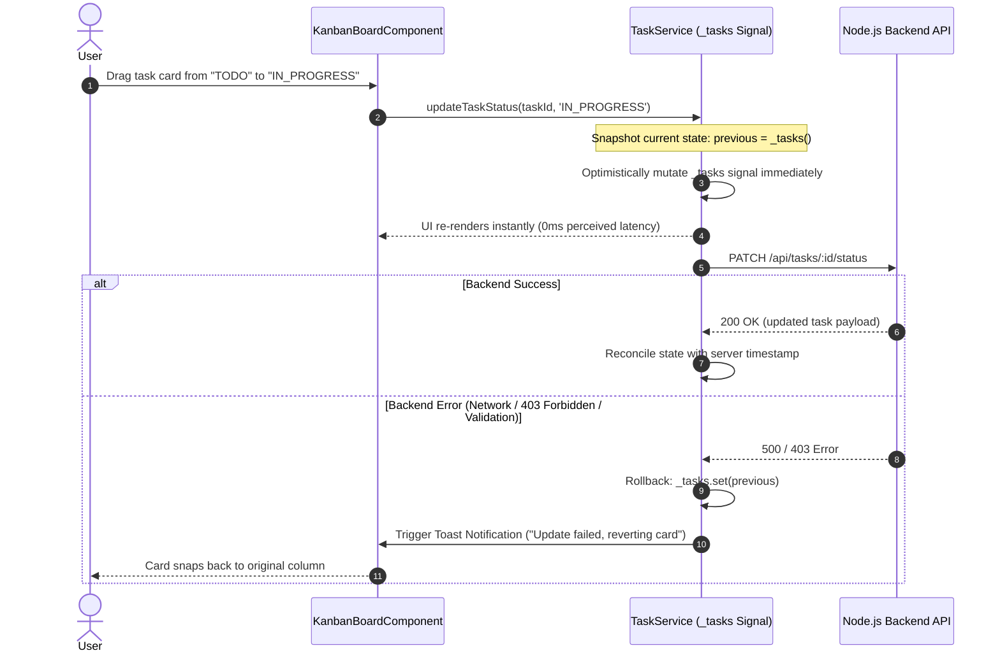

# State Management in Nexus PMS

This document outlines the state management architecture, philosophy, and implementation patterns utilized across **Nexus PMS**.

---

## 1. State Management Philosophy

Modern Angular (v16+) introduces first-class reactive primitives: **Angular Signals**. With Signals integrated deeply into change detection (`ChangeDetectionStrategy.OnPush`), standard Angular applications no longer need heavy, boilerplate-heavy external state management libraries (like NgRx Store, Akita, or Ngxs) for typical enterprise domains.

Instead, Nexus PMS adheres to a **Pragmatic Reactive Architecture**:
1. **Local & Component State**: Managed via native Angular `signal()`, `computed()`, and `model()` primitives.
2. **Global & Domain State**: Encapsulated in Singleton Services (`@Injectable({ providedIn: 'root' })`) exposing read-only signals to consumers and mutating state via explicit methods.
3. **Asynchronous Streams & Events**: Handled via **RxJS** where operators (`debounceTime`, `switchMap`, `catchError`, `takeUntilDestroyed`) provide unrivaled power.
4. **State Bridging**: Converting between RxJS Observables and Signals using Angular's `@angular/core/rxjs-interop` (`toSignal`, `toObservable`).

---

## 2. When to Use What: Architectural Decision Matrix

| State Type | Mechanism | Why? | Example in Nexus PMS |
| :--- | :--- | :--- | :--- |
| **Component UI State** | `signal<T>()` | Zero boilerplate, fine-grained DOM tracking, synchronous reads without `async` pipe. | Filter search query, active tab index, modal open/close states. |
| **Derived State** | `computed<T>()` | Memoized, glitch-free computation. Recalculates strictly when dependent signals change. | `filteredTasks()`, `isFormValid()`, `kpiMetrics()`. |
| **Shared Global Domain State** | Signal Store Pattern in Root Service | Single source of truth, testable, encapsulated mutations without action/reducer overhead. | `AuthService.currentUser()`, `TaskService.tasks()`, `ThemeService.isDark()`. |
| **Real-time Event Streams** | RxJS `Subject` / `Observable` | Handles event streams over time, reconnection backoff, buffer windows, SSE message bus. | `RealtimeService.events$`, search input debouncing. |
| **Side Effects / DOM Sync** | `effect()` | Synchronizes reactive state with non-Angular APIs (e.g., `localStorage`, `document.body.classList`). | Applying dark mode class to `document.documentElement` in `ThemeService`. |
| **Heavy Enterprise Entity Caching** | NgRx ComponentStore / NgRx SignalStore | Recommended *only* if normalizing hundreds of relational entities with undo/redo history. Nexus PMS demonstrates that root Signal services achieve identical ergonomics with 90% less code. | *Evaluated & omitted to prevent unnecessary bloat.* |

---

## 3. The Signal-Based Service Store Pattern

Nexus PMS implements a clean **Signal Store Pattern** within domain services.

### Pattern Anatomy
1. **Private Writeable Signal**: Internal state mutation is restricted to the service itself.
2. **Public Read-Only Signal**: Components consume state via `.asReadonly()` to prevent arbitrary external mutations.
3. **Computed Selectors**: Pre-calculated views of the state that update reactively.
4. **Explicit Command Methods**: Async methods that execute HTTP calls, update signals, and trigger telemetry.

### Implementation: `TaskService` (`src/app/core/services/task.service.ts`)

```typescript
@Injectable({ providedIn: 'root' })
export class TaskService {
  private readonly http = inject(HttpClient);
  private readonly toast = inject(ToastService);

  // 1. Private writable state
  private readonly _tasks = signal<Task[]>([]);
  private readonly _loading = signal<boolean>(false);
  private readonly _error = signal<string | null>(null);

  // 2. Public read-only exposure
  readonly tasks = this._tasks.asReadonly();
  readonly loading = this._loading.asReadonly();
  readonly error = this._error.asReadonly();

  // 3. Computed selectors (derived signals)
  readonly todoTasks = computed(() => this._tasks().filter(t => t.status === 'TODO'));
  readonly inProgressTasks = computed(() => this._tasks().filter(t => t.status === 'IN_PROGRESS'));
  readonly inReviewTasks = computed(() => this._tasks().filter(t => t.status === 'IN_REVIEW'));
  readonly doneTasks = computed(() => this._tasks().filter(t => t.status === 'DONE'));

  // 4. Command mutation method
  loadTasks(projectId?: string): void {
    this._loading.set(true);
    this._error.set(null);

    let params = new HttpParams();
    if (projectId) params = params.set('projectId', projectId);

    this.http.get<{ data: Task[] }>(`${this.apiUrl}/tasks`, { params }).subscribe({
      next: (res) => {
        this._tasks.set(res.data);
        this._loading.set(false);
      },
      error: (err) => {
        this._error.set(err.message || 'Failed to load tasks');
        this._loading.set(false);
      }
    });
  }
}
```

---

## 4. Optimistic UI Updates & Error Rollbacks

In high-velocity workflows like Kanban drag-and-drop, waiting for backend network round-trips creates perceptible lag. Nexus PMS employs **Optimistic State Updates** with rollback safeguards.

### Flow Diagram



### Implementation Example
```typescript
updateTaskStatus(taskId: string, newStatus: TaskStatus): void {
  const previous = this._tasks();
  
  // 1. Optimistic local update
  this._tasks.update(tasks =>
    tasks.map(t => t.id === taskId ? { ...t, status: newStatus } : t)
  );

  // 2. Network synchronization
  this.http.patch<ApiResponse<Task>>(`${this.apiUrl}/tasks/${taskId}/status`, { status: newStatus })
    .subscribe({
      next: (res) => {
        // Sync server response
        this._tasks.update(tasks => tasks.map(t => t.id === taskId ? res.data : t));
      },
      error: (err) => {
        // 3. Rollback on failure
        this._tasks.set(previous);
        this.toast.show('Failed to update task status. Reverted changes.', 'error');
      }
    });
}
```

---

## 5. RxJS & Angular Signals Interoperability

While Signals excel at managing synchronous values and rendering UI, **RxJS** remains essential for handling asynchronous stream operators (search debouncing, interval polling, and Server-Sent Events).

Nexus PMS bridges both worlds seamlessly:

### Debounced Live Search
In `KanbanBoardComponent`:
```typescript
searchControl = new FormControl('');

// Using RxJS to debounce user keystrokes
ngOnInit(): void {
  this.searchControl.valueChanges.pipe(
    debounceTime(250),
    distinctUntilChanged(),
    takeUntilDestroyed(this.destroyRef)
  ).subscribe(query => {
    // Write into signal for reactive template computation
    this.searchQuery.set(query ?? '');
  });
}
```

### Real-Time Telemetry via Server-Sent Events (SSE)
`RealtimeService` maintains an active EventSource stream. When incoming events arrive, it dispatches them into reactive Signals:
```typescript
private initEventStream(): void {
  this.eventSource = new EventSource('/api/realtime/stream');
  
  this.eventSource.addEventListener('TASK_UPDATED', (e) => {
    const task: Task = JSON.parse(e.data);
    // Broadcast via Subject for stream consumers
    this.events$.next({ type: 'TASK_UPDATED', payload: task });
    // And seamlessly notify TaskService to refresh or patch its Signal
    this.taskService.handleRemoteUpdate(task);
  });
}
```

---

## 6. Shared vs. Feature-Scoped State

```
                      +------------------------+
                      |    Application Root    |
                      +-----------+------------+
                                  |
         +------------------------+------------------------+
         |                        |                        |
         v                        v                        v
+------------------+    +------------------+    +------------------+
|   AuthService    |    |   ThemeService   |    |  ToastService    |
|  (Global User,   |    |   (Light/Dark    |    |  (Global Toast   |
|   Roles, Token)  |    |     Signal)      |    |    Queue Signal) |
+------------------+    +------------------+    +------------------+
         |                        |                        |
         +------------------------+------------------------+
                                  |
                                  v
                    +----------------------------+
                    |    Feature Lazy Modules    |
                    +-------------+--------------+
                    |             |              |
                    v             v              v
           +--------------+ +--------------+ +--------------+
           |ProjectService| | TaskService  | | OrgService   |
           |(Project list | |(Kanban board,| |(Team roster, |
           | & selection) | | task filters)| | role manager)|
           +--------------+ +--------------+ +--------------+
```

1. **Global Tier**: Singleton services that survive route changes (`AuthService`, `ThemeService`, `ToastService`).
2. **Feature Domain Tier**: Services that manage collection lifecycles (`ProjectService`, `TaskService`). State persists across child navigation within the feature.
3. **Component View Tier**: Ephemeral signals created inside components (e.g. form submission state, modal visibility). Cleaned up automatically upon component destruction.

---

## 7. Performance & Change Detection Architecture

Nexus PMS operates on **100% `ChangeDetectionStrategy.OnPush`**:
- Angular skips change detection subtrees unless a signal read within the template changes, an `@Input()` reference updates, or an event listener fires.
- Template bindings read signals directly: `{{ taskService.tasks().length }}`.
- Angular 19 fine-grained graph dependency ensures that only the exact DOM nodes bound to updated signals get marked dirty, eliminating unnecessary parent-to-child tree traversals.
